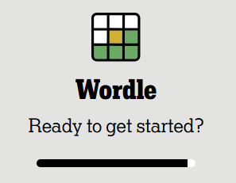
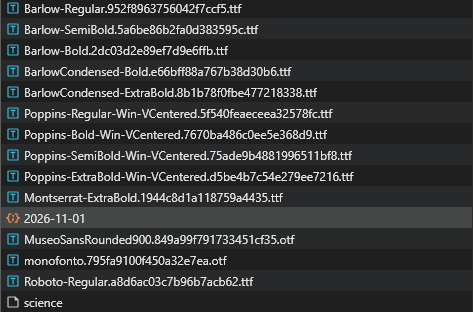
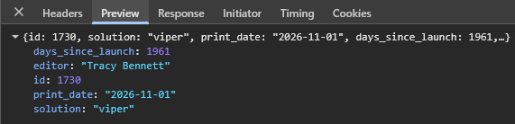

# Move in one with Wordle.
Using Discord's New York Times Wordle activity, you can easily 'guess' the answer just by reading your incoming/outgoing requests.

>[!TIP]
>If you dont want to be a boring, just play the game normally.

>[!NOTE]
>This was last updated on 11/1/2026. Security and fairness changes could've been which could've made this method obsolete.


## Setup

1. First go into your settings, scroll down to find a Developer Tab in the settings window.
2. Turn on Developer Mode.
3. Before starting the wordle activity, open your Inspection Menu; using <kbd>Ctrl</kbd> + <kbd>Shift</kbd> + <kbd>I</kbd>.
4. Head to your Network Tab in the Horizontal Container at the Top.
5. Start the activity through `/wordle`, or any other method to start the activity.

##  Finding Solution

As soon as your wordle, reaches this point before even pressing play. The solution has already been recieved.

<div align="center">



</div>

___

Within your pool, you should see several items look for one with a date like title, it is usually formatted as `YEAR-MONTH-DAY` like so here with `2026-11-1` which is simply just _November 1st of 2026_. 

<div align="center">



</div>

___

When you click it, a window to the right of it will have a popup of the request information (Headers). Click the Preview tab on the same window to see the solution.

The solution will be seen at Key `solution` and its Value is the solution to the wordle, the request is already formatted/broken into line breaks for readability.

<div align="center">



</div>

___

### Faster/Easier Method
Because the solution is global or relative to only a date rather than a unique identifier, a simple endpoint can just be accessed. For this you must have [Python Installed](https://www.python.org/downloads/) on your machine.

Then run these commands in your command prompt.

```bash
python
```

``` python
import json, urllib.request
from datetime import date

today = date.today().strftime("%Y-%m-%d")
url = f"https://www.nytimes.com/svc/wordle/v2/{today}.json"

req = urllib.request.Request(url, headers={"User-Agent": "Mozilla/5.0"})
data = json.load(urllib.request.urlopen(req))

solution = data['solution'].upper()

print(f"Solution for today is \"{solution}\"")
```